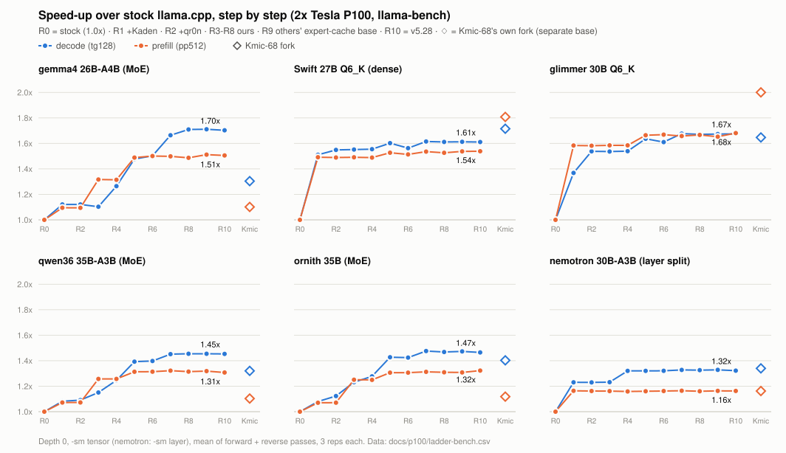
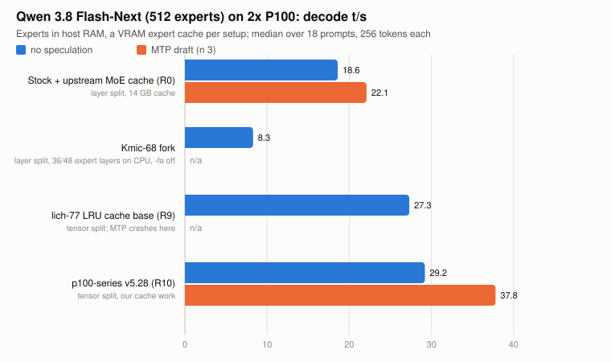

# p100-series performance

What each group of patches in `p100-series` buys on NVIDIA Tesla P100s, measured step by step from stock llama.cpp to the
`p100-series-v5.28` release, with Kmic-68's own fork as a reference point. Everything was measured in one campaign (2026-10-23) on
one machine, against one upstream base ([`c7fc50941`](https://github.com/ggml-org/llama.cpp/commit/c7fc50941)), so the steps are
directly comparable.

## Summary

Serving with the exact production settings (llama-server, decode tokens/s, mean of a chat, a triage and an edit request):

| model | quant | stock llama.cpp | Kmic-68 fork | p100-series v5.28 | vs stock |
|---|---|---:|---:|---:|---:|
| gemma4 26B-A4B (MoE) | UD-Q4_K_XL (QAT) | 64.6 | 81.0 | **108.7** | **1.68x** |
| Swift 27B, MTP + ngram-mod speculation | Q6_K | 33.2 | 54.0 | **55.8** | **1.68x** |
| qwen36 35B-A3B (MoE) | UD-Q5_K_XL | 58.1 | 81.9 | **88.5** | **1.52x** |
| ornith 35B (MoE) | Q5_K_M | 59.7 | 84.2 | **90.6** | **1.52x** |
| glimmer 30B | UD-Q6_K_XL | 18.2 | 29.5 | **30.1** | **1.65x** |
| nemotron 30B-A3B (layer split) | UD-Q4_K_XL | 70.5 | 94.4 | **94.0** | **1.33x** |
| Qwen 3.8 Flash-Next (512 experts, host-RAM experts + VRAM cache), MTP | IQ2_XS (GSQ-RCO); MTP head Q8_0 (stock) / Q5_K reduced-vocab (v5.28) | 22.1 | n/a (8.3 without MTP) | **37.8** | **1.71x** |

Prompt processing in serving is 1.15-1.6x faster (Flash-Next ~3.3x), and the stack is also **more accurate than stock** on every
accuracy set we run: for example gemma4 single-token decode KL divergence vs an F32 reference drops from 0.0073 to 0.00028, and
Swift's from 0.00032 to 0.000003 (100 % same top token).

<picture>
  <source media="(prefers-color-scheme: dark)" srcset="ladder-dark.svg">
  
</picture>

## How it was measured

Exact model files (with sha256), llama-bench flags, serving command lines, environment and accuracy-set flags for every model
below: [SETTINGS.md](SETTINGS.md).

The published branch is upstream plus a linear stack of 176 code patches. Each **step** below is a real commit of that stack
(every step builds and runs), so a step's gain is measured exactly where those patches sit. The order follows the stack, because
later work builds directly on earlier work (our MoE kernels extend qr0n's, our expert cache extends lich-77's).

| step | adds | patches | by |
|---|---|---|---|
| R0 | stock llama.cpp [`c7fc50941`](https://github.com/ggml-org/llama.cpp/commit/c7fc50941) | -- | upstream |
| K | Kmic-68's own fork, tip [`d90ec36a3`](https://github.com/Kmic-68/llama.cpp/commit/d90ec36a3) (its own, older upstream base; built with `-DGGML_CUDA_FA_QUANTS=all` and a one-line `#include <algorithm>` for gcc 15) | -- | Kaden |
| [R1](https://github.com/wispoffates/llama.cpp/compare/c7fc50941...53d0f76e0) | the sm_60 matvec rebuild, fp16 Q6_K verify matvecs, cuBLAS ALGO6 prefill, sampler prefilter, MTP catch-up | 33 | Kaden (32), wrj97 (1, server-only) |
| [R2](https://github.com/wispoffates/llama.cpp/compare/53d0f76e0...8afabede3) | fp16 GP100 matvec for Q4_K / Q5_K / Q8_0 | 1 | qr0n (patches 0007, 0008) |
| [R3](https://github.com/wispoffates/llama.cpp/compare/8afabede3...44f7ad75b) | hybrid MoE matvec, Pascal tile GEMM (verify batches, MoE prefill) | 12 | ours |
| [R4](https://github.com/wispoffates/llama.cpp/compare/44f7ad75b...6fa2b9911) | decode kernels: h1 fp16 one-column matvec, short-K, tied-output split, FA tile skip, lighter host path | 21 | ours |
| [R5](https://github.com/wispoffates/llama.cpp/compare/6fa2b9911...6c9532cd4) | two-GPU tensor-split engine: one host thread per GPU, in-kernel P2P AllReduce (+ fused norm) | 10 | ours |
| [R6](https://github.com/wispoffates/llama.cpp/compare/6c9532cd4...77205241c) | fusions and fp16 accuracy: h1 GLU, DRY-aware prefilter, q6_K fp16 one column, pruned topk_moe | 14 | ours |
| [R7](https://github.com/wispoffates/llama.cpp/compare/77205241c...8ed61d402) | AllReduce LL protocol, add+norm+mul fusion, gemma4 launch merges, h1s short-K MoE | 18 | ours |
| [R8](https://github.com/wispoffates/llama.cpp/compare/8ed61d402...6b97c4f4c) | fixes: NaN-safe FA masking, recurrent-state clear (qr0n 0014), buffer sizing (qr0n 0017), topk_moe regs | 8 | ours, qr0n |
| [R9](https://github.com/wispoffates/llama.cpp/compare/6b97c4f4c...f753efd54) | expert-cache base: pipeline parallelism with host experts, GPU-resident MoE LRU cache, host-weight offload | 10 | drrros (5), lich-77 (2), ours with buun (3) |
| [R10](https://github.com/wispoffates/llama.cpp/compare/f753efd54...99a6cf6a8) | our expert cache + Flash-Next work (= `p100-series-v5.28` code) | 49 | ours |

**Hardware:** 2x Tesla P100-PCIE-16GB (VBIOS 86.00.41.00.06, 150 W cap) on one PCIe switch with P2P, passed through to an
8-vCPU Ubuntu 26.04 VM on a Ryzen 7 2700 (46 GiB RAM), driver 580.178.04, CUDA 12.4. `GGML_CUDA_P2P=1` everywhere.

**Runs:** llama-bench `-p 512 -n 128 -r 3`, `-fa 1`, tensor split (nemotron: layer split; Swift `-ts 49.3/50.7`), every step run
forward then in reverse order with a warm-up first, GPUs cooled to 65 C between runs; the two passes agree within ~1.5 %.
Serving uses each model's exact llama-swap command line and environment (flags a step doesn't know are dropped and listed; none
were). Accuracy is KL divergence against full-F32 GPU reference logits on chat-formatted text (the gate sets every release uses).
Raw data: [`ladder-bench.csv`](ladder-bench.csv), [`ladder-kld.csv`](ladder-kld.csv), [`ladder-serve.csv`](ladder-serve.csv).

## Results by contributor

### Kaden (Kmic-68): the foundation for dense models

Kaden's 32 patches (R1) are the single biggest step for the dense Q6_K models: Swift decode 17.4 -> 26.3 t/s (**+51 %**) and
prefill 220 -> 328 (+49 %), glimmer decode +37 %, nemotron +23 %. They also fix most of stock's dense prefill error: cuBLAS ALGO6 and
the fp16 Q6_K path take Swift prefill KL divergence from 0.0037 to 0.000075 and glimmer's to effectively zero.

**Kmic-68's own fork (K)** is still the fastest build we have measured for dense Q6_K prompt processing: Swift prefill 397 vs our
338 t/s (llama-bench), glimmer 407 vs 342, and in serving 345 vs 296 t/s at ~6K tokens. That comes from parts of his fork we have not
taken (the gemm-fold prefill path) and is a known gap. His llama-bench Swift decode is 6 % ahead of ours (29.9 vs 28.1), while in
serving with speculation ours is ahead (55.8 vs 54.0). On the MoE models our stack is clearly faster (gemma4 decode +31 %, qwen36 +10 %,
MoE prefill +18-37 %). Two caveats for his fork on this hardware: single-token decode (`-ub 1`) of qwen36 and ornith under tensor split
stops with "illegal memory access", and qwen36 at 16K depth crashed in llama-bench; those cells are marked n/a / crash.

### Other contributors

- **qr0n** (R2, plus two fixes in R8): the fp16 GP100 matvec kernels add glimmer decode +12 % and lower nemotron decode KL divergence
  from 0.0138 to 0.0098; the hybrid matvec built on them (R3, ours) is worth 5-8 % of qwen36 decode today (see the switch table).
  The recurrent-state fill fix (0014) is a correctness fix (a slot whose state went NaN stayed broken until restart).
- **drrros, lich-77, buun** (R9): the base of the expert cache. These patches leave the six regular models unchanged (as expected)
  and make the Flash-Next work in R10 possible; see the Flash-Next section.
- **wrj97** (in R1): keeps the draft model's KV out of context checkpoints (server memory, no speed change).

### Ours (R3-R8, R10)

| step | what it did (largest effects) |
|---|---|
| R3 tile GEMM + hybrid MoE | MoE prefill +17-20 % (gemma4 772 -> 928, qwen36 793 -> 930, ornith 774 -> 904 t/s) |
| R4 decode kernels | gemma4 decode +15 % (76 -> 87), qwen36 +8 %, nemotron +7 %; gemma4 decode KL divergence 0.0072 -> 0.0024 |
| R5 tensor-split engine | gemma4 decode +17 % (87 -> 102), qwen36 / ornith +12 %, gemma4 prefill +13 %; serving gemma4 prefill +33 % |
| R6 fusions / fp16 | Swift decode KL divergence 0.00026 -> 0.000003 (q6_K fp16 one column), ornith 0.013 -> 0.0096 |
| R7 AllReduce LL + merges | gemma4 decode another +11 % (104 -> 115); gemma4 decode KL divergence 0.0023 -> 0.00028 |
| R8 fixes | no speed change (correctness: NaN-safe attention masking, recurrent-state clear, buffer sizing) |
| R10 expert cache + Flash-Next | no change on the six regular models; Flash-Next 1.71x decode, ~3.3x prefill vs stock (below) |

## Flash-Next: a 512-expert model that doesn't fit in VRAM

Qwen 3.8 Flash-Next (Swift-1.5 IQ2_XS, 68 GB in two GGUF parts) is much larger than the two cards together, so its experts live in host RAM and each setup
keeps a cache of experts in VRAM. Three setups, same prompts (18 prompts x 256 tokens, decode median), same 16K context:

<picture>
  <source media="(prefers-color-scheme: dark)" srcset="flashnext-dark.svg">
  
</picture>

| setup | decode, no speculation | decode, MTP draft | prefill ~1K / ~5K / ~11K tokens | VRAM per GPU |
|---|---:|---:|---|---:|
| stock + upstream's MoE cache (layer split; upstream's cache refuses tensor split) | 18.6 | 22.1 | 75 / 79 / 74 | 9.9 GB |
| Kmic-68 fork (layer split, 36 of 48 expert layers on the CPU, flash attention off) | 8.3 | n/a | 77 / crash / -- | -- |
| lich-77 LRU cache base (R9: lich-77 + drrros + buun) | 27.3 | crash | 61 / 62 / 65 | 12.6 GB |
| **p100-series v5.28 (R10)** | **29.2** | **37.8** | **221 / 251 / 268** | 13.9 GB |

- lich-77's cache with tensor split is already 1.47x stock's decode. Our cache work on top (exclusive cache, copy-engine assembly,
  profile-warm start, per-layer slot budgets, prefill through the cache pools, sparse flash attention for the QSA layers, Pascal
  kernels for the 2-bit experts) adds +7 % plain decode, **~4x prefill**, and makes MTP speculation work: with the reduced-vocabulary
  MTP head, v5.28 decodes at 37.8 t/s, **1.71x stock with MTP** (draft acceptance is the same in both, 0.59-0.60).
- At R9 the MTP draft crashes (a stack overflow in `libggml-base` at the first decode: the draft model also got LRU pools; our next
  commit keeps drafts out of the cache) and the cache needs `--load-mode none` (with mmap, the host-buffer overrides it relies on are
  dropped and no pools are allocated: 3.8 t/s). Both are fixed in R10.
- Kmic-68's fork runs it only in its slowest form: no tensor split for this architecture and no MoE cache, so experts that don't fit
  run on the CPU (36 of 48 expert layers; fewer runs out of VRAM). Flash attention has to be off: with it on, his compact I32
  attention mask reaches `ggml_fill` in the QSA layers and aborts. It cannot load the standalone MTP head, and prompts beyond
  ~2K tokens stop with "illegal memory access" (the 1K prefill and all 18 decode prompts completed). Cherry-picking upstream #28569 (which re-enabled
  tensor split for this architecture on 10-01, after his base) lets tensor split load, but it then needs flash attention, and with
  the compact mask disabled (`LLAMA_KQ_MASK_COMPACT_MIN`) it stops at startup with the same illegal memory access.

**How the v5.28/v5.29 numbers are served** (see [SETTINGS.md](SETTINGS.md) for all models; production command line, paths shortened; tensor split is required -- the expert cache
and the Flash-Next kernels are built and measured for `-sm tensor` only):

```bash
GGML_CUDA_P2P=1 LLAMA_MOE_LRU_EXCLUSIVE=1 GGML_CUDA_LRU_DMA=1 LLAMA_MOE_LRU_PREFETCH=1 GGML_CUDA_LRU_ASYNC=1 \
LLAMA_MOE_LRU_PROFILE=profile-flashnext.txt LLAMA_MOE_LRU_SLOTS=slots-flashnext.txt \
llama-server --model Swift-Qwen3.8-Flash-Next-GSQ-RCO-IQ2_XS-00001-of-00002.gguf \
  --model-draft mtp-Qwen3.8-Flash-Next-Q5_K-frspec-65k-conv.gguf --spec-type draft-mtp --spec-draft-n-max 3 --spec-draft-p-min 0.0 \
  --ctx-size 16384 --n-gpu-layers 99 --fit off --flash-attn on --split-mode tensor -lzm on --no-repack \
  --n-cpu-moe 999 --moe-lru-slots 256 -ub 512 -b 2048 --parallel 1 --jinja
```

- Experts go to host memory with `--n-cpu-moe 999` (not `-ot`); the model is memory-mapped (default load mode) on a 46 GiB-RAM host.
- `LLAMA_MOE_LRU_PROFILE` (warm start) and `LLAMA_MOE_LRU_SLOTS` (per-layer slot budgets) are optional data files from our traces;
  without them the cache starts cold with 256 uniform slots (about 5 % slower decode).
- The `-conv` MTP head is the frequency-ranked 65k-row head converted for our reduced-vocabulary loader (d2t); with the plain Q8_0 MTP
  head expect ~31 t/s. Without MTP: 29.2 t/s.
- Driver 580.178.04, CUDA 12.4 toolchain. sha256: part 1 `ca3b302d…7743b`, part 2 `e4996a6d…c9dbb`, MTP head (frspec-65k, before
  conversion) `282764bf…c48b9`, converted head `4166a416…9e932`, Q8_0 head `b9880220…74f4ec`.

## Accuracy

Accuracy: KL divergence vs a full-F32 GPU reference (lower is better; same top token %).

| set | stock (R0) | Kmic fork | +Kaden (R1) | R4 | R7 | v5.28 (R10) |
|---|---:|---:|---:|---:|---:|---:|
| gemma4 prefill | 0.004059 (98.5%) | 0.003806 (98.3%) | 0.003401 (98.6%) | 0.002910 (99.0%) | 0.003668 (99.0%) | 0.001870 (99.1%) |
| gemma4 decode | 0.007265 (96.7%) | 0.006947 (97.0%) | 0.007156 (96.6%) | 0.002433 (99.0%) | 0.000279 (99.6%) | 0.000279 (99.6%) |
| gemma4 verify4 | 0.006869 (97.3%) | 0.006594 (97.6%) | 0.007557 (97.1%) | 0.002689 (98.6%) | 0.002438 (98.6%) | 0.002438 (98.6%) |
| swift prefill | 0.003736 (97.8%) | 0.000054 (99.8%) | 0.000075 (99.8%) | 0.000075 (99.8%) | 0.000075 (99.8%) | 0.000075 (99.8%) |
| swift decode | 0.000321 (99.3%) | 0.000278 (99.5%) | 0.000517 (99.6%) | 0.000262 (99.6%) | 0.000003 (100.0%) | 0.000003 (100.0%) |
| swift verify4 | 0.000334 (99.5%) | 0.000040 (99.9%) | 0.000136 (99.8%) | 0.000002 (99.9%) | 0.000002 (99.9%) | 0.000002 (99.9%) |
| qwen36 prefill | 0.003376 (98.3%) | 0.001967 (99.0%) | 0.002417 (98.8%) | 0.001730 (99.0%) | 0.001730 (99.0%) | 0.001730 (99.0%) |
| qwen36 decode | 0.001835 (98.7%) | crash | 0.002210 (99.0%) | 0.001340 (98.9%) | 0.001486 (99.0%) | 0.001486 (99.0%) |
| ornith decode | 0.021688 (96.0%) | crash | 0.020606 (96.3%) | 0.013137 (97.2%) | 0.009552 (97.2%) | 0.009552 (97.2%) |
| nemotron decode | 0.013640 (96.7%) | 0.012614 (97.5%) | 0.013800 (97.3%) | 0.008800 (97.7%) | 0.008800 (97.7%) | 0.008800 (97.7%) |
| glimmer prefill | 0.002013 (97.5%) | 0.000093 (99.8%) | 0.000000 (100.0%) | 0.000000 (100.0%) | 0.000000 (100.0%) | 0.000000 (100.0%) |

prefill = 4 x 2048 tokens; decode = one token at a time (-ub 1), 3 x 1024; verify4 = 4-token batches (speculative verify width).

## What each feature is worth today

v5.28 (R10) with one feature switched off at a time (environment switches), change in llama-bench tokens/s:

| feature turned off | gemma4 decode | gemma4 prefill | Swift 27B decode | Swift 27B prefill | qwen36 decode | qwen36 prefill |
|---|---:|---:|---:|---:|---:|---:|
| (R10 as shipped, tokens/s) | 117.7 | 1069.6 | 28.2 | 339.3 | 93.2 | 976.0 |
| threaded dispatch (GGML_META_THREADS=0) | -18.7% | -7.2% | -3.9% | -2.4% | -13.0% | -4.3% |
| in-kernel AllReduce (GGML_META_AR=0) | -11.1% | -0.8% | -2.8% | +0.1% | -5.7% | +0.7% |
| AllReduce LL protocol (GGML_CUDA_AR_LL=0) | -5.1% | -1.0% | -1.2% | -0.7% | -2.3% | +0.2% |
| h1 fp16 one-column matvec (GGML_CUDA_MMVQ_H1=0) | -8.0% | -0.5% | -0.5% | +0.3% | -1.5% | +0.7% |
| h1 gate/up GLU fusion (GGML_CUDA_MMVQ_H1_GLU=0) | -2.6% | +0.0% | -0.4% | -1.3% | -2.0% | +0.2% |
| h1s short-K MoE (GGML_CUDA_MMVQ_H1S=0) | -3.3% | -1.3% | -0.6% | -1.7% | -0.4% | +0.7% |
| add+RMS norm+mul fusion (GGML_CUDA_FUSE_ADD_NORM=0) | +0.3% | -0.9% | -0.7% | -0.4% | -2.4% | -0.1% |
| gemma4 launch merges (GGML_CUDA_FUSE_TAIL/SETROWS_AHEAD/FA_H1/GLU_Q8/MOE_SCALE=0) | -8.9% | -2.0% | -0.4% | -1.7% | +0.1% | -0.1% |
| fp16 Q6_K verify matvec, Kaden (GGML_CUDA_MMVQ_F16=0) | +0.2% | +0.2% | -0.4% | -1.1% | +0.2% | -0.5% |
| q6_K fp16 one column (GGML_CUDA_MMVQ_F16_1COL=0) | +0.1% | -0.0% | -0.5% | -0.1% | +0.1% | +0.3% |
| q6_K BIG1 geometry (GGML_CUDA_MMVQ_F16_BIG1=0) | +0.1% | -1.1% | -2.5% | -0.2% | +0.2% | +0.4% |
| hybrid fp16 matvec, qr0n kernels (GGML_CUDA_HYBRID_MMVQ=0) | +0.1% | +0.4% | +1.0% | +0.0% | -5.0% | +0.7% |
| hybrid MoE matvec (GGML_CUDA_HYBRID_MMVQ_ID=0) | +0.3% | -1.4% | -0.4% | -1.8% | -7.5% | -0.8% |
| Pascal tile GEMM (GGML_CUDA_TILE_MAX=0) | +0.3% | +0.3% | -0.5% | -2.0% | +0.0% | -0.2% |
| Pascal MoE gate/up/GLU fusion (GGML_CUDA_PASCAL_MOE_GLU=0) | +0.0% | +0.1% | -0.3% | -1.6% | +0.1% | +0.5% |
| short-K 16-bit matvec (GGML_CUDA_MMVF_SHORTK=0) | +0.2% | -0.3% | -0.5% | -0.3% | -0.0% | +0.5% |
| q8_1 activation cache, Kaden (GGML_CUDA_GP100_NO_ACT_CACHE=1) | +0.5% | -1.6% | -0.6% | -0.6% | -1.1% | +0.5% |

Base run repeated at start and end: largest drift 1.1% -- treat changes under ~1% as noise.

## Full tables

### llama-bench, every step (tokens/s, depth 0; gemma4 and qwen36 also at 16K depth)

| model | test | R0 | Kmic fork | R1 | R2 | R3 | R4 | R5 | R6 | R7 | R8 | R9 | R10 | R10 vs R0 |
|---|---|---:|---:|---:|---:|---:|---:|---:|---:|---:|---:|---:|---:|---:|
| gemma4 | decode | 69.0 | 90.0 | 77.3 | 77.3 | 76.1 | 87.2 | 101.9 | 103.6 | 114.8 | 117.9 | 118.0 | 117.5 | **1.70x** |
| gemma4 | decode at 16K | 66.2 | 85.6 | 73.7 | 73.8 | 72.5 | 82.6 | 95.6 | 96.8 | 107.9 | 109.9 | 109.9 | 109.5 | **1.65x** |
| gemma4 | prefill | 704.9 | 776.4 | 771.9 | 771.6 | 928.2 | 926.6 | 1049.4 | 1057.9 | 1056.4 | 1047.9 | 1065.4 | 1061.0 | **1.51x** |
| gemma4 | prefill at 16K | 549.0 | 678.1 | 582.6 | 587.0 | 674.1 | 680.4 | 734.9 | 729.9 | 739.7 | 734.6 | 734.2 | 732.1 | **1.33x** |
| Swift 27B | decode | 17.4 | 29.9 | 26.3 | 27.0 | 27.1 | 27.1 | 27.9 | 27.3 | 28.2 | 28.1 | 28.1 | 28.1 | **1.61x** |
| Swift 27B | prefill | 219.9 | 397.5 | 327.9 | 327.4 | 327.9 | 327.4 | 335.7 | 332.9 | 337.7 | 335.6 | 338.0 | 338.2 | **1.54x** |
| glimmer | decode | 18.3 | 30.2 | 25.1 | 28.2 | 28.1 | 28.2 | 30.0 | 29.5 | 30.7 | 30.6 | 30.6 | 30.7 | **1.67x** |
| glimmer | prefill | 203.5 | 407.1 | 322.3 | 321.9 | 322.4 | 322.4 | 338.6 | 339.5 | 337.3 | 339.1 | 336.2 | 342.0 | **1.68x** |
| qwen36 | decode | 64.1 | 84.6 | 69.3 | 69.9 | 73.8 | 79.9 | 89.3 | 89.6 | 93.1 | 93.2 | 93.2 | 93.2 | **1.45x** |
| qwen36 | decode at 16K | 63.6 | n/a | 69.5 | 68.9 | 73.5 | 77.0 | 85.5 | 86.0 | 89.5 | 89.6 | 89.6 | 89.4 | **1.41x** |
| qwen36 | prefill | 739.3 | 815.3 | 792.2 | 792.6 | 929.5 | 929.5 | 971.0 | 971.5 | 977.2 | 971.5 | 974.5 | 966.7 | **1.31x** |
| qwen36 | prefill at 16K | 585.4 | 707.8 | 620.1 | 622.2 | 713.2 | 718.2 | 740.1 | 741.5 | 741.0 | 741.4 | 738.2 | 734.4 | **1.25x** |
| ornith | decode | 62.3 | 87.4 | 67.2 | 69.9 | 76.7 | 79.5 | 88.9 | 88.7 | 91.9 | 91.4 | 91.7 | 91.2 | **1.47x** |
| ornith | prefill | 723.0 | 808.5 | 773.7 | 774.2 | 904.0 | 903.3 | 944.2 | 944.3 | 949.0 | 946.5 | 945.8 | 956.3 | **1.32x** |
| nemotron | decode | 72.6 | 97.2 | 89.3 | 89.3 | 89.4 | 95.8 | 95.8 | 95.9 | 96.4 | 96.3 | 96.4 | 96.0 | **1.32x** |
| nemotron | prefill | 422.6 | 491.0 | 491.9 | 491.1 | 490.7 | 489.7 | 490.3 | 491.1 | 492.0 | 490.4 | 491.7 | 491.4 | **1.16x** |

### Serving with the exact production settings (llama-server, decode tokens/s, mean of chat / triage / edit)

| entry | stock (R0) | Kmic fork | +Kaden (R1) | +qr0n (R2) | +tensor-split engine (R5) | R7 | v5.28 (R10) | R10 vs R0 |
|---|---:|---:|---:|---:|---:|---:|---:|---:|
| gemma4 | 64.6 | 81.0 | 70.9 | 69.6 | 88.8 | 107.1 | 108.7 | **1.68x** |
| Swift 27B (MTP + ngram-mod) | 33.2 | 54.0 | 48.7 | 49.1 | 55.6 | 56.1 | 55.8 | **1.68x** |
| qwen36 | 58.1 | 81.9 | 67.6 | 68.8 | 87.3 | 86.9 | 88.5 | **1.52x** |
| ornith | 59.7 | 84.2 | 67.1 | 67.3 | 86.5 | 89.2 | 90.6 | **1.52x** |
| glimmer | 18.2 | 29.5 | 24.8 | 28.0 | 29.3 | 30.1 | 30.1 | **1.65x** |
| nemotron | 70.5 | 94.4 | 87.4 | 87.7 | 93.4 | 94.1 | 94.0 | **1.33x** |

### Serving prefill (llama-server, prompt tokens/s for a ~5-6K and a ~11-13K-token prompt; exact count depends on the tokenizer)

| entry | prompt | stock (R0) | Kmic fork | +Kaden (R1) | +qr0n (R2) | +tensor-split engine (R5) | R7 | v5.28 (R10) | R10 vs R0 |
|---|---|---:|---:|---:|---:|---:|---:|---:|---:|
| gemma4 | ~5-6K | 709 | 723 | 752 | 750 | 998 | 984 | 994 | **1.40x** |
| gemma4 | ~11-13K | 680 | 751 | 720 | 719 | 967 | 967 | 966 | **1.42x** |
| Swift 27B (MTP + ngram-mod) | ~5-6K | 197 | 345 | 287 | 287 | 297 | 296 | 296 | **1.50x** |
| Swift 27B (MTP + ngram-mod) | ~11-13K | 195 | 347 | 283 | 283 | 288 | 286 | 288 | **1.48x** |
| qwen36 | ~5-6K | 640 | 712 | 684 | 686 | 859 | 865 | 860 | **1.34x** |
| qwen36 | ~11-13K | 619 | 700 | 662 | 663 | 845 | 845 | 838 | **1.35x** |
| ornith | ~5-6K | 628 | 698 | 665 | 667 | 833 | 840 | 844 | **1.34x** |
| ornith | ~11-13K | 591 | 671 | 632 | 633 | 822 | 826 | 820 | **1.39x** |
| glimmer | ~5-6K | 187 | 329 | 280 | 281 | 302 | 302 | 302 | **1.61x** |
| glimmer | ~11-13K | 184 | 334 | 277 | 277 | 301 | 303 | 301 | **1.64x** |
| nemotron | ~5-6K | 658 | 741 | 755 | 755 | 757 | 757 | 758 | **1.15x** |
| nemotron | ~11-13K | 706 | 818 | 807 | 807 | 810 | 811 | 808 | **1.14x** |

## Caveats

- Steps are cumulative in stack order. A group's gain depends on what is already below it; the switch table above is the second
  view (what each feature is worth inside v5.28 today). Changes under ~1 % are within run-to-run noise.
- Each step is measured with the best flags it supports; the production command lines needed no changes on any step.
- Kmic-68's fork is on an older upstream base and includes work we didn't take (gemm-fold prefill, CUDA graphs on Pascal, q4_0-KV
  attention kernels), so it is a reference column, not a step. It was run with our flags, not its own recommended ones (it suggests
  q4_0 KV and a 262K context for Swift).
- One machine, one card pair, one driver. Other Pascal cards (P40, P4, GTX 10xx: sm_61) take some of the same paths but were not
  measured here.

## Reproduce

Each step is the commit linked in the step table above. Scripts (llama-bench ladder + switch table, KL divergence,
serving + Flash-Next) and the chart/table generators are in the maintainer's bench-tools repository (not public yet) (`kmic-split/phaseLD*.sh`,
`ladder/`); the tables here are generated from the CSVs in this directory.
